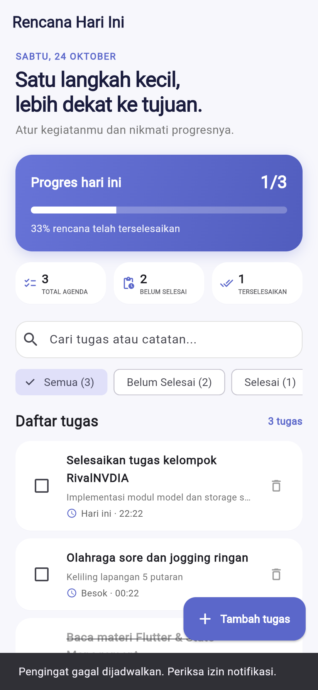
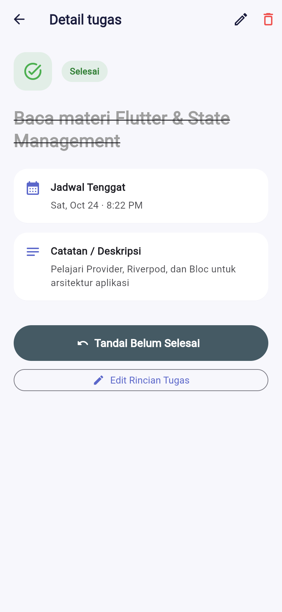
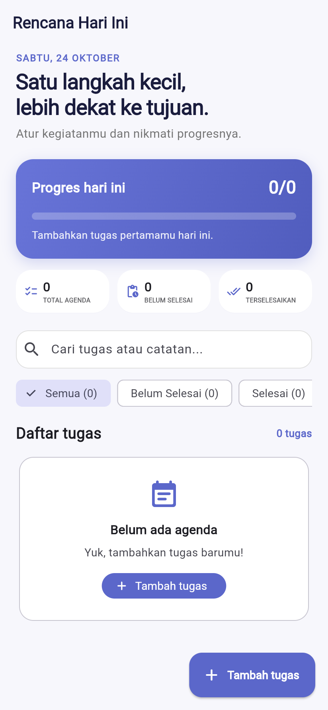

<div align="center">

# Rencana Hari Ini

### Aplikasi Manajemen Tugas & Pengingat Tenggat Berbasis Flutter


</div>

**Rencana Hari Ini** adalah aplikasi produktivitas yang dirancang untuk membantu mencatat agenda harian, mengatur tanggal dan jam tenggat waktu, memantau progres tugas, serta menjadwalkan notifikasi pengingat otomatis di perangkat.

---

## Pratinjau Antarmuka

<div align="center">
	
	&nbsp;&nbsp;
	
	&nbsp;&nbsp;
	
</div>

---

## Fitur Utama

- **Pencatatan Tugas Lengkap**: Tambah tugas dengan nama tugas, catatan/keterangan rincian, dan jadwal tenggat waktu opsional.
- **Edit & Perbarui Tugas**: Ubah judul, deskripsi, maupun jadwal tugas yang sudah tersimpan melalui layar detail.
- **Pencarian Cepat (*Search Bar*)**: Cari tugas secara instan berdasarkan judul atau isi catatan.
- **Filter Status Agenda**: Saring tugas berdasarkan kategori: *Semua*, *Belum Selesai*, atau *Selesai*.
- **Pemantauan Progres Harian**: Kartu progres dengan persentase otomatis dan kartu ringkasan jumlah agenda.
- **Format Waktu Pintar (*Smart Time*)**: Tampilan waktu yang menyesuaikan konteks (*Hari ini*, *Besok*, *Kemarin*, atau tanggal spesifik).
- **Penghapusan Aman & *Undo***: Konfirmasi saat menghapus tugas serta tombol **"URUNGKAN"** (*Undo*) jika tugas terhapus secara tidak sengaja.
- **Penyimpanan Lokal (*Offline Persistence*)**: Seluruh data tersimpan otomatis di perangkat menggunakan `shared_preferences`.
- **Pengingat Notifikasi Lokal**: Pengingat otomatis terjadwal 10 menit sebelum tenggat waktu tiba.
- **Dukungan Dark Mode & Light Mode**: Desain antarmuka fleksibel yang nyaman di mata baik siang maupun malam hari.

---

## Teknologi yang Digunakan

| Komponen | Kegunaan |
| --- | --- |
| **Flutter & Dart** | Framework UI & logika aplikasi multi-platform |
| **`shared_preferences`** | Penyimpanan data tugas secara lokal di perangkat |
| **`flutter_local_notifications`** | Pengiriman dan penjadwalan notifikasi alarm lokal |
| **`timezone` & `flutter_timezone`** | Sinkronisasi zona waktu lokal perangkat untuk alarm presisi |

---

## Panduan Instalasi & Menjalankan Aplikasi

Berikut adalah langkah-langkah lengkap untuk menyiapkan lingkungan pengembangan dari awal hingga aplikasi siap dijalankan.

### 1. Prasyarat Sistem

1. **Git**: Pastikan Git sudah terinstal di komputer ([Download Git](https://git-scm.com/)).
2. **Flutter SDK**: Diperlukan Flutter SDK versi 3.13 atau lebih baru.
   - Jika belum memiliki Flutter SDK di Windows, Anda bisa meng-clone SDK resmi langsung ke direktori pilihan (misal `D:\flutter`):
     ```powershell
     git clone https://github.com/flutter/flutter.git -b stable D:\flutter
     ```
   - Tambahkan folder `bin` Flutter (contoh: `D:\flutter\bin`) ke **Environment Variables** (`PATH`) pengguna.
   - Buka terminal baru dan jalankan diagnosa:
     ```bash
     flutter doctor
     ```
3. **Target Perangkat**:
   - **Untuk Web**: Cukup gunakan browser **Google Chrome** atau **Microsoft Edge** (paling mudah & cepat).
   - **Untuk Android**: Pasang **Android Studio** dan buat Emulator Android, atau hubungkan HP fisik dengan mode *USB Debugging* aktif.

---

### 2. Mengambil Proyek dari GitHub

Clone repositori ini ke komputer Anda:

```bash
git clone https://github.com/nuby911/prooject-RivalNVDIA.git
cd prooject-RivalNVDIA
```

---

### 3. Mengunduh Dependensi Proyek

Jalankan perintah berikut untuk mengunduh seluruh library yang dibutuhkan:

```bash
flutter pub get
```

---

### 4. Menjalankan Aplikasi

Pilih salah satu platform target yang ingin digunakan:

#### A. Menjalankan di Browser (Web Chrome)
```bash
flutter run -d chrome
```
*Atau dengan port tertentu:*
```bash
flutter run -d chrome --web-port 8080
```

#### B. Menjalankan di Perangkat Android / Emulator
```bash
flutter run -d android
```

#### C. Menjalankan di Desktop Windows
*(Pastikan opsi Developer Mode sudah diaktifkan di Windows Settings)*
```bash
flutter run -d windows
```

> **Tips Interaktif saat Aplikasi Berjalan:**
> - Tekan tombol **`r`** di terminal untuk melakukan **Hot Reload** (memperbarui UI seketika).
> - Tekan tombol **`R`** untuk **Hot Restart** (restart aplikasi dari awal).
> - Tekan tombol **`q`** untuk berhenti menjalankan aplikasi.

---

## Pengujian & Verifikasi Kualitas Kode

Aplikasi ini dilengkapi pengujian otomatis (*Unit & Widget Testing*) untuk menjamin keandalan fitur.

1. **Menjalankan Seluruh Pengujian:**
   ```bash
   flutter test
   ```
   *Mencakup pengujian penyimpanan data lokal, manipulasi tugas, render antarmuka, pencarian, dan pemulihan tugas (undo).*

2. **Memeriksa Integritas Kode (Linter & Static Analysis):**
   ```bash
   flutter analyze
   ```

---

## Build untuk Produksi (Android APK)

Untuk membuat file installer `.apk` rilis:

```bash
flutter build apk --release
```

Hasil file APK akan tersedia di:
`build/app/outputs/flutter-apk/app-release.apk`

---

## Struktur Folder Proyek

```text
lib/
├── main.dart                      # Titik awal aplikasi (Entrypoint & Root Widget)
├── models/
│   └── task.dart                  # Model data Task & konversi JSON/Map
├── screens/
│   ├── home_screen.dart           # Layar utama (daftar tugas, progres, filter & pencarian)
│   ├── add_task_screen.dart       # Form tambah dan edit tugas
│   └── detail_task_screen.dart    # Layar rincian detail tugas
├── services/
│   ├── notification_service.dart  # Layanan penjadwalan notifikasi & pengingat
│   └── storage_service.dart       # Layanan penyimpanan lokal (SharedPreferences)
├── theme/
│   └── app_theme.dart             # Konfigurasi tema warna asli (Light & Dark Mode)
└── widgets/
    ├── empty_task.dart            # Widget tampilan state kosong
    ├── task_card.dart             # Komponen kartu tugas
    └── task_tile.dart             # Komponen baris tugas
test/
├── storage_service_test.dart      # Unit test layanan penyimpanan data
└── widget_test.dart               # Widget test antarmuka, form, filter, dan interaksi
```
